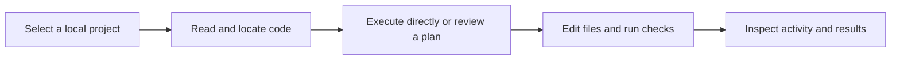

<h1 align="center">CodeWeft</h1>

<p align="center"><strong>A local AI coding workbench that makes the execution process visible.</strong></p>

<p align="center">
  <a href="README.md">简体中文</a> · <strong>English</strong> ·
  <a href="#quick-start">Quick start</a> · <a href="docs/README.md">Documentation</a> ·
  <a href="#how-it-works">How it works</a>
</p>

<p align="center">
  <a href="LICENSE"></a>
  
</p>

Connect your own model to explore an existing project, plan changes, and run checks. Follow tool calls, task progress, collaboration, and results in the web workbench, or use the agent runtime from the command line or Python.


*The workbench after a local task: projects and conversations on the left, the delivery report in the center, and run statistics and context usage on the right. Click the image to view the original.*

## Features

- **Follow the work as it happens.** Inspect tool calls, tasks, modified file paths, and model usage. Conversations and execution records are stored locally.
- **Understand and plan before editing.** Explore a project in read-only mode, or review a plan before approving execution. Repository overviews, keyword and structural search help locate code; vector retrieval is optional.
- **Delegate when the task calls for it.** New web conversations can delegate one task, delegate a batch, or execute a dependency plan. Plan execution supports staged checks and local delivery. [Compare the three execution paths](docs/collaboration.md).
- **Manage context for longer tasks.** Check request budgets against the model window and summarize earlier history. Large tool results are paged and archived with follow-up reading links.
- **Choose your models and tools.** Use Anthropic Messages, OpenAI Chat Completions, or Responses. Extend workflows with Skills, MCP, and long-term memory. Attachment support depends on the selected model and configuration.

<details>
<summary>See collaboration in action: an inventory, orders, and reporting plan</summary>


This example organizes inventory, orders, reporting, and integration checks into four tasks. The interface shows dependencies, stage checks, and local delivery status. Dependency levels do not imply simultaneous execution; see [Collaboration](docs/collaboration.md) for scheduling and verification details.

</details>

## Quick start

Start with the **web workbench**. You need **Python 3.11+, Git, Node.js 22.12+, and npm**, plus your own endpoint, model ID, and API key for a model that supports tool calling.

### 1. Install and launch

Windows PowerShell:

```powershell
git clone https://github.com/jerry021211/CodeWeft.git
cd CodeWeft
python -m venv .venv
.\.venv\Scripts\python.exe -m pip install -e ".[web]"
npm.cmd --prefix web ci
npm.cmd --prefix web run build
.\.venv\Scripts\python.exe -m codeagent.web.cli --workspace . --port 8765
```

<details>
<summary>macOS / Linux</summary>

```bash
git clone https://github.com/jerry021211/CodeWeft.git
cd CodeWeft
python3 -m venv .venv
.venv/bin/python -m pip install -e ".[web]"
npm --prefix web ci
npm --prefix web run build
.venv/bin/python -m codeagent.web.cli --workspace . --port 8765
```

</details>

The Python package, commands, and configuration variables retain the `codeagent` name. These commands use the virtual environment's Python directly, so activation is not required.

### 2. Configure a model and select a project

Open [http://127.0.0.1:8765](http://127.0.0.1:8765), then select **Settings → Models and capabilities** (设置 → 模型与能力) at the bottom of the sidebar. Choose a conversation protocol, enter your model settings, and save. You do not need to create `.env` before the first launch. See [Model services](docs/model-services.md) for protocol and configuration details.

Click **New project** (新建项目) and select an existing local directory. That directory becomes the conversation's workspace. The current interface uses Chinese labels; English translations here identify the corresponding controls.

### 3. Complete your first request

Click the **Agent** button below the composer to open the execution mode menu, select **Read-only** (只读), and send:

> Map this project's entry points, main modules, and test commands. Include the key file paths.

Your first run is complete when you can see tool execution records and a project overview with file paths. To make changes, switch back to **Agent**. You can also enable **Plan first** (先出方案), review the plan, and choose **Approve and execute** (批准并执行). Approving a plan does not remove an existing read-only restriction. See [Plan mode](docs/plan-mode.md).

## Three tasks to try

Adapt the requests to the code in your project:

| Goal | Mode | Example request |
| --- | --- | --- |
| Explore the code | Read-only | Trace a request from its entry point to data access. Identify the relevant files and tests. |
| Plan a feature | Agent + Plan first | Add CSV export to this module. Investigate its interfaces and tests, then submit an implementation plan. |
| Fix a bug | Agent | Fix this endpoint's exception on empty input, add a regression test, and report the changes and check results. |

## Other ways to use CodeWeft

**Command line.** For CLI-only use, create and activate a virtual environment in the CodeWeft repository, then install the core package with `python -m pip install -e .`. Node.js and the frontend build are not required. Keep that environment active, enter your target project directory, and configure your model using [Model services](docs/model-services.md) before running:

```bash
codeagent --read-only "Explain this project's architecture and test entry points"
codeagent "Fix the issue and run the relevant tests"
codeagent
```

The CLI uses the current directory as its workspace. Running without a prompt starts an interactive session. Place `.env` in the directory where you launch the CLI or a parent directory, or set process environment variables. Changing projects does not automatically load `.env` from the installation repository. Model settings saved through the web UI can be shared when using the same data directory and take precedence over the corresponding environment variables. See [.env.example](.env.example).

**Python SDK.** Create an `Agent`, register tools, and call `agent.run(...)` from your script. See the [Usage guide](docs/usage-guide.md). Native collaboration and Plan first are provided by the web host; CLI and base SDK tooling and planning entry points differ. See [Architecture and entry points](docs/architecture.md).

## How it works



The Python agent runtime connects model requests to tool execution, with permissions, context management, and budgets governing each run. The web host uses FastAPI, SQLite, and event streams to persist and display activity; the frontend uses React and TypeScript. See the [Architecture guide](docs/architecture.md) for module responsibilities, collaboration paths, and a source reading order.

## Scope and boundaries

### Read-only permissions

Read-only mode restricts the agent's writes, delegation, and external tool calls. It is a tool execution policy, **not an operating system sandbox**. The runtime still saves conversations and events. See [Read-only permissions](docs/usage-guide.md#只读权限).

### Local runtime and data

The web workbench is intended for local, single-user use and listens only on localhost. Runtime data is stored outside the repository by default; set `CODEAGENT_DATA_DIR` to choose a location. Requests to models, embedding providers, web search, and MCP services are sent to the configured services.

### Multiple agents and recovery

Direct delegation and read-only plans work in the current project. Plans with write tasks use managed collaboration workspaces, checks, and local writeback without automatically pushing to a remote. Ordinary conversations targeting the same directory still share files. A restart does not automatically replay unfinished operations; see [Collaboration](docs/collaboration.md) for continuation and recovery. Legacy Teams remain for compatibility. CVM verification supervision is off by default; see the [Documentation index](docs/README.md).

## Documentation

The detailed guides below are currently in Chinese.

| Reading goal | Start here |
| --- | --- |
| Configure and use the workbench | [Usage guide](docs/usage-guide.md) · [Model services](docs/model-services.md) · [Plan mode](docs/plan-mode.md) |
| Understand task collaboration | [Native collaboration](docs/collaboration.md) · [Concurrent sessions](docs/concurrent-sessions.md) |
| Study or extend the runtime | [Architecture](docs/architecture.md) · [Code retrieval](docs/code-search.md) · [Context and tool output](docs/tool-output-policy.md) |
| Develop and reproduce evaluations | [Contributing](CONTRIBUTING.md) · [Evaluation entry points](evals/README.md) |

The [full documentation index](docs/README.md) also covers optional experiments and historical designs.

## Development and validation

Reproducible bug reports and improvement suggestions are welcome through [Issues](https://github.com/jerry021211/CodeWeft/issues). See [Contributing](CONTRIBUTING.md) for development setup, tests, and submission guidance, and the [Web development guide](web/README.md) for frontend work.

## License

This project is licensed under the [MIT License](LICENSE).
