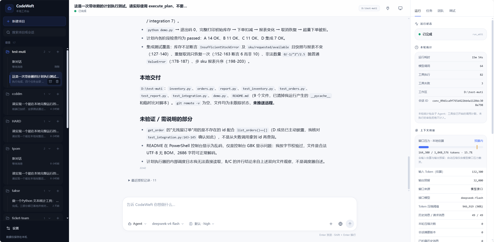
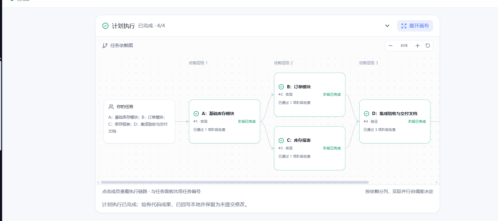
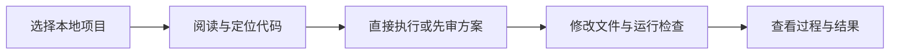

<h1 align="center">CodeWeft</h1>

<p align="center"><strong>看得见执行过程的本地 AI 编程工作台。</strong></p>

<p align="center">
  <strong>简体中文</strong> · <a href="README.en.md">English</a> ·
  <a href="#快速开始">快速开始</a> · <a href="docs/README.md">使用文档</a> ·
  <a href="#工作原理">工作原理</a>
</p>

<p align="center">
  <a href="LICENSE"></a>
  
</p>

连接你自己的模型，在已有项目中查找实现、规划修改并运行检查。通过 Web 工作台查看工具调用、任务进度、协作状态与执行结果，也可以通过命令行或 Python 接入 Agent 运行时。



*一次本地任务结束后的工作台：左侧管理项目与会话，中间查看交付说明，右侧展示运行统计与上下文用量。点击图片可查看原图。*

## 核心能力

- **看清每一步执行。** 在对话中跟踪工具调用，查看任务、修改文件和模型用量；会话与执行记录保存在本机。
- **先理解，再动手。** 选择只读方式分析项目，或开启“先出方案”，查看实施步骤后批准执行。项目概览、关键词与结构化检索帮助定位代码，可按需配置向量检索。
- **按任务需要协作。** 新 Web 会话可以委派单任务、批量任务，或执行带依赖的计划；计划执行支持阶段检查与本地交付。[了解三种执行方式](docs/collaboration.md)。
- **为长任务管理上下文。** 根据模型窗口检查请求预算、摘要较早历史；较大的工具结果分页并归档，保留后续回读入口。
- **接入自己的模型与工具。** 支持 Anthropic Messages、OpenAI Chat Completions 和 Responses，通过 Skills、MCP 与长期记忆扩展项目工作流。附件能力取决于所选模型与配置。

<details>
<summary>查看协作实例：库存、订单与报表的依赖计划</summary>



示例将基础库存、订单、报表和集成验收组织为四个任务，界面显示依赖关系、阶段检查和本地交付状态。依赖分层不等于实际同时执行，调度与验证机制见[协作指南](docs/collaboration.md)。

</details>

## 快速开始

推荐先体验 **Web 工作台**。准备 **Python 3.11+、Git、Node.js 22.12+ 和 npm**，以及支持工具调用的模型服务地址、模型名称和密钥。

### 1. 安装并启动

Windows PowerShell：

```powershell
git clone https://github.com/jerry021211/CodeWeft.git
cd CodeWeft
python -m venv .venv
.\.venv\Scripts\python.exe -m pip install -e ".[web]"
npm.cmd --prefix web ci
npm.cmd --prefix web run build
.\.venv\Scripts\python.exe -m codeagent.web.cli --workspace . --port 8765
```

<details>
<summary>macOS / Linux</summary>

```bash
git clone https://github.com/jerry021211/CodeWeft.git
cd CodeWeft
python3 -m venv .venv
.venv/bin/python -m pip install -e ".[web]"
npm --prefix web ci
npm --prefix web run build
.venv/bin/python -m codeagent.web.cli --workspace . --port 8765
```

</details>

Python 包、命令和配置变量继续使用 `codeagent` 名称。以上命令直接使用虚拟环境中的 Python，无需先激活环境。

### 2. 配置模型并选择项目

打开 [http://127.0.0.1:8765](http://127.0.0.1:8765)，进入左侧底部的 **设置 → 模型与能力**，选择对话协议，填写模型信息并保存。首次启动无需先创建 `.env`；协议与配置说明见[模型服务](docs/model-services.md)。

点击 **新建项目**，选择要操作的已有本地目录。该目录会成为会话的工作区。

### 3. 完成第一次请求

点击输入框下方的 **Agent** 按钮，打开执行方式菜单，选择 **只读**，发送：

> 梳理这个项目的入口、主要模块和测试方式，给出关键文件路径。

看到工具执行记录，以及带文件路径的项目说明，就完成了首次体验。准备修改时，切换回 **Agent**；也可以开启 **先出方案**，审阅后点击 **批准并执行**。批准方案不会解除已有的只读权限，具体流程见[方案模式](docs/plan-mode.md)。

## 从这三个任务开始

按项目实际内容调整需求：

| 想做什么 | 工作方式 | 示例请求 |
| --- | --- | --- |
| 熟悉代码 | 只读 | 找到请求从入口到数据访问的调用路径，说明涉及的文件和测试。 |
| 规划功能 | Agent + 先出方案 | 为现有模块增加 CSV 导出，先调查接口与测试，提交实施方案。 |
| 修复问题 | Agent | 修复这个接口在空输入时的异常，补充回归测试，说明改动和检查结果。 |

## 其他使用方式

**命令行。** 只使用 CLI 时，在 CodeWeft 仓库目录创建并激活虚拟环境，安装核心包 `python -m pip install -e .`，无需 Node.js 或前端构建。保持该环境激活，进入目标项目目录，并按[模型服务](docs/model-services.md)配置模型后运行：

```bash
codeagent --read-only "解释这个项目的架构和测试入口"
codeagent "修复问题并运行相关测试"
codeagent
```

CLI 使用当前目录作为工作区；不传提示词会进入交互会话。若使用 `.env`，应放在实际启动目录或其父目录，也可直接设置进程环境变量；切换项目不会自动读取安装仓库中的 `.env`。同一数据目录下通过 Web 保存的模型设置可共用，并优先于对应环境变量。配置示例见 [.env.example](.env.example)。

**Python SDK。** 在脚本中创建 `Agent`、注册工具并调用 `agent.run(...)`，见[使用指南](docs/usage-guide.md)。Web 原生协作与“先出方案”由 Web 宿主提供；CLI 和基础 SDK 的工具与规划入口有所不同，见[架构与入口](docs/architecture.md)。

## 工作原理



Python Agent 运行时连接模型请求与工具执行，权限、上下文和预算约束每次运行。Web 使用 FastAPI、SQLite 和事件流保存并呈现过程，前端由 React + TypeScript 实现。模块职责、协作路径与源码阅读顺序见[架构导览](docs/architecture.md)。

## 使用边界

### 只读权限

只读方式限制 Agent 的写入、委派与外部工具调用，是工具执行策略，**不是操作系统沙箱**。运行时仍会保存会话和事件。详见[只读权限](docs/usage-guide.md#只读权限)。

### 本地运行与数据

Web 面向本地单用户，仅监听本机地址。数据默认保存在仓库外的运行时目录，可用 `CODEAGENT_DATA_DIR` 指定位置。模型、向量检索、联网搜索和 MCP 请求会发送到配置的服务。

### 多 Agent 与恢复

直接委派和纯只读计划在当前项目中工作；有写任务的计划使用受管理的协作目录、检查与本地回写，不自动推送远程。同目录的普通会话仍共享文件。重启不会自动重放未完成操作，继续与恢复方式见[协作指南](docs/collaboration.md)。旧 Team 保留历史兼容；CVM 验证监督默认关闭，详见[文档索引](docs/README.md)。

## 文档导航

| 阅读目的 | 入口 |
| --- | --- |
| 配置和使用工作台 | [使用指南](docs/usage-guide.md) · [模型服务](docs/model-services.md) · [先出方案](docs/plan-mode.md) |
| 理解任务协作 | [原生协作](docs/collaboration.md) · [多会话并发](docs/concurrent-sessions.md) |
| 学习和扩展运行时 | [架构导览](docs/architecture.md) · [代码检索](docs/code-search.md) · [上下文与工具输出](docs/tool-output-policy.md) |
| 开发与复现评测 | [贡献指南](CONTRIBUTING.md) · [评测入口](evals/README.md) |

更多使用说明、实验能力与历史设计见[完整文档索引](docs/README.md)。

## 开发与验证

欢迎通过 [Issues](https://github.com/jerry021211/CodeWeft/issues) 提交可复现的问题或改进建议。开发环境、测试命令与提交要求见[贡献指南](CONTRIBUTING.md)，前端开发见 [Web 开发说明](web/README.md)。

## 致谢

项目设计参考了 [shareAI-lab/learn-claude-code](https://github.com/shareAI-lab/learn-claude-code) 对 Agent loop、工具、权限与记忆的分层组织，并在此基础上实现本地 Web 工作台、上下文管理、代码检索与协作。

Weft 是织物的纬线；CodeWeft 取意于将模型、工具与 Agent 协作连接到本地项目的开发流程。

## 开源协议

本项目采用 [MIT License](LICENSE)。
