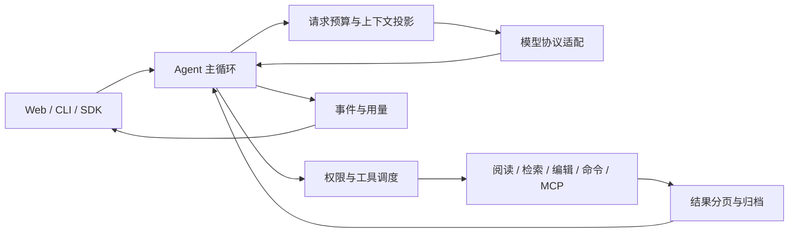

# 项目架构

[文档导航](README.md) · [使用指南](usage-guide.md) · [贡献指南](../CONTRIBUTING.md)

CodeWeft 以 Python 实现 Agent 运行时，以 FastAPI 和 React 提供本机 Web 工作台，同时保留 CLI 与 Python SDK。共同核心是一个反复请求模型、执行工具、回传结果的循环；Web 负责会话、队列、持久化和界面，原生协作在这个核心上调度多个成员。

## 一次任务如何运行

1. 入口装配模型客户端、工作区工具、权限、提示词、上下文管理和事件接收器。
2. Agent 接受用户输入，在每轮请求前核对取消与执行预算，并组装实际发送给模型的上下文。
3. 模型返回工具调用时，运行时先检查权限，再按工具副作用安排执行。独立安全读取可以并行，写入和未知副作用形成串行边界。
4. 工具结果保留状态与来源；长结果归档并提供有界页面，模型可按需继续读取。结果进入下一轮，直到回复、等待、取消或预算终止。
5. Web 将事件、会话和检查点持久化，并通过 SSE 更新界面。CLI 和 SDK 使用相同 Agent 核心，但不因此具备全部 Web 会话管理功能。

主循环见 [`agent.py`](../codeagent/agent.py)，Web 的装配与调度见 [`factory.py`](../codeagent/web/factory.py) 和 [`scheduler.py`](../codeagent/web/scheduler.py)。

## 模块地图

| 模块 | 职责 |
| --- | --- |
| [`codeagent/agent.py`](../codeagent/agent.py) | 主循环、工具结果回传、普通子 Agent 协调 |
| [`config.py`](../codeagent/config.py)、[`providers.py`](../codeagent/providers.py)、[`anthropic_client.py`](../codeagent/anthropic_client.py) | 配置、Anthropic / OpenAI 协议、流式输出和用量适配 |
| [`prompts/`](../codeagent/prompts)、[`context/`](../codeagent/context) | 提示词组装、请求预算、摘要、历史投影和输出归档 |
| [`tools/`](../codeagent/tools)、[`code_search/`](../codeagent/code_search)、[`code_intelligence/`](../codeagent/code_intelligence)、[`lsp/`](../codeagent/lsp) | 文件与命令工具、词法和结构检索、可选向量召回、语言服务 |
| [`permissions/`](../codeagent/permissions)、[`hooks/`](../codeagent/hooks) | 只读策略、审批、生命周期观察和控制 |
| [`runtime/`](../codeagent/runtime)、[`recovery/`](../codeagent/recovery) | 取消、执行预算、并行、检查进程和模型错误恢复 |
| [`tasks/`](../codeagent/tasks)、[`multiagent/`](../codeagent/multiagent)、[`worktrees/`](../codeagent/worktrees) | 持久任务、依赖调度、成员执行、Git 快照和本地交付 |
| [`skills/`](../codeagent/skills)、[`memory/`](../codeagent/memory)、[`mcp/`](../codeagent/mcp) | 按需加载技能、长期记忆和外部工具接入 |
| [`events/`](../codeagent/events)、[`web/`](../codeagent/web) | 事件、SQLite、HTTP API、队列和会话宿主 |
| [`web/src/`](../web/src) | React 界面、运行记录、任务与文件变化展示 |
| [`cvm/`](../codeagent/cvm) | 可选任务契约、证据和验证建议；默认关闭 |
| [`legacy/teams/`](../codeagent/legacy/teams) | 旧 Team 的历史记录与执行兼容 |

## 三个重要边界

### 上下文不是全部历史的原样重发

`ContextManager` 区分保存的历史与本次请求视图。它按模型窗口检查预算，在压力下处理旧工具结果并生成分块摘要，保留近期交互和原文回读入口。摘要会压缩信息，归档帮助追溯，不等于无限或无损上下文。

检索也有明确范围：Python、Java、JavaScript 和 TypeScript 等已配置语言提供结构化信息；向量服务可选，失败时可回退到词法检索。搜索返回的覆盖和降级信息不能省略为“已完整理解整个仓库”。详见 [代码检索](code-search.md) 与 [工具输出策略](tool-output-policy.md)。

### 权限、观察与执行控制分工不同

权限策略决定工具能否运行。Hook 的观察者记录事实，控制处理器可以阻断或改变流程；观察者返回值不直接控制执行。执行预算和取消独立于上下文压缩，逻辑执行最多 200 轮，第 185 轮开始提示收尾。

只读保护是工具和命令策略，不是操作系统沙箱。模型错误恢复处理可重试请求、上下文超限等问题；服务重启后的检查点恢复则需要核对执行现场，不能把两者等同为自动重放工具。参见 [只读权限](usage-guide.md#只读权限) 和 [执行预算](loop-guard.md)。

### 原生协作复用 Task 和 Agent

新建 Web 普通会话提供原生委派工具；已有会话按检查点保持原工具集合。CLI/SDK 的普通运行时保留 `subagent`：默认继承权限、前台串行执行，显式只读子任务才可并行或后台运行。整个会话启用只读保护时禁止委派。新 Web 原生委派不是 CLI/SDK 默认附带的同名入口。

原生协作使用现有 Task 的定义、依赖与状态，另存成员执行阶段和检查点。依赖方向为 `multiagent → tasks / runtime / worktrees`，共享模块不反向依赖旧 Team。单任务/批量委派直接使用当前项目；计划执行使用受管理工作目录，在检查后回写本地。详见 [多 Agent 协作](collaboration.md) 和 [目录边界](multiagent-layout.md)。

CVM 与这套协作验收分开配置。CVM 默认关闭，目前的验证建议既不自动运行检查，也不保证任务正确；[真实对照结果](cvm-step2-results-2026-10-13.md)尚未证明提醒改善成功率。

## 建议的源码阅读顺序

1. 从 [`cli.py`](../codeagent/cli.py) 或 [`web/factory.py`](../codeagent/web/factory.py) 看一次 Agent 如何装配。
2. 沿 [`Agent._run`](../codeagent/agent.py) 阅读“请求 → 工具 → 结果”的循环，再看一个具体工具，如 [`read.py`](../codeagent/tools/read.py)。
3. 阅读 [`context/manager.py`](../codeagent/context/manager.py) 及 [`test_context_runtime.py`](../tests/test_context_runtime.py)，对照请求投影与历史保留。
4. 阅读 [`multiagent/adapter.py`](../codeagent/multiagent/adapter.py)、[`coordinator.py`](../codeagent/multiagent/coordinator.py) 及 [`test_native_execution.py`](../tests/test_native_execution.py)，理解装配、验证和交付。
5. 修改功能前查阅相邻测试与 [贡献指南](../CONTRIBUTING.md)，将实际行为、对应文档和验证方式一起更新。
