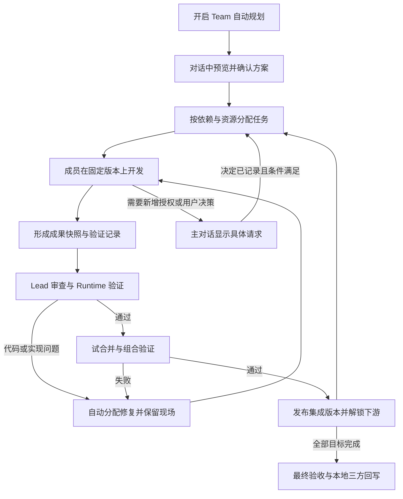

# Agent Team 协作机制迁移方案

建议在现有 Python 后端中迁移天枢的任务协调、范围诊断、有限修复和状态展示机制，保留已经实现的 Agent 执行、会话缓存、独立 Worktree、版本集成与本地回写。第一阶段继续采用每个 Attempt 独立 Worktree；共享工作区作为后续可选能力。核心目标是：日常开发问题由团队自己处理，确实需要用户决定时，用户能直接看清原因并操作。

本方案适用于代码库、命令行程序、单体服务、前端应用、库、数据处理及文档任务，不以 SeatFlow 或前后端拆分为前提。前十七节保留研究与设计依据；本轮实际落地范围、验证及剩余项见第十八节，不能把设计条目全部视为已实现。

**一、研究版本与结论边界**

2026 年 10 月 13 日核对时，用户本地 `D:\tianshu-harness\Tianshu-harness` 为 `abb76289278fc2679cb1adac3dab06ebb74eeb6b`；远程 `main` 为 `81924691de67364dddd4beb00829a2217452b072`，提交时间为 2026 年 10 月 12 日 22:38，包版本为 `3.30.0`。已独立取得远程快照研究，未更新用户指定的本地仓库。

当前 CodeWeft 基于 `2d391855a5afd0dce900921dcd52b602e98f5274`，研究同时包含工作目录中尚未提交的 CVM、Hook 和界面改动。实施时必须以这些实际接口为基线，不能覆盖或撤回它们。

天枢公开仓库能直接看到 coordinator、工单、工作区隔离、审批、恢复、TUI 和 sidecar 的相关实现；桌面端及部分高级能力不在公开仓库。因此可以迁移已核实的机制，不能承诺逐项复制闭源桌面行为。公开边界见 [AGENTS.md](https://github.com/huiliyi37/Tianshu-harness/blob/81924691de67364dddd4beb00829a2217452b072/AGENTS.md#L27)。

本次运行了天枢的 42 项独立测试，涵盖隔离决策、调度建议门槛、并发建议和续跑判断，全部通过。其他链路结合实现和测试源码交叉核对，未运行真实模型团队、完整应用集成或闭源桌面程序。通过这些独立测试不等于已证明迁移后的多 Agent 效果。

**二、天枢实际如何工作，以及迁移取舍**

| 机制 | 最新公开代码的实际行为 | 本项目采用的方式 |
| --- | --- | --- |
| 结构化任务 | 工单携带目标、依赖、文件范围、验证要求、能力和预算；任务按依赖及冲突分组 | 保留现有 Task/Attempt，补完整的输入成果、验收要求和调整协议 |
| 共享与隔离 | 生产装配允许共享；有文件范围、未声明与主控重叠的普通分片通常共享 cwd；审查补丁等重叠写工隔离 | 一期保留独立 Attempt Worktree；后续增加专用 Team 工作区中的共享组 |
| 范围偏差 | 波次结束后比较实际 diff 与计划文件；偏差进入提示和审查，不凭这项检查直接冻结 | 任务文件范围改为分工信息；真正授权边界单独约束 |
| 冲突控制 | 派发前检查声明的文件是否冲突；工具层另有跨会话文件认领 | 区分同一目录中的真实写冲突与不同 Worktree 的潜在合并冲突 |
| 局部修复 | 写入验证启用且实际失败、状态及预算允许时，在原工作区内给同一 Worker 至多一次修复；环境阻断不进入这次返工 | 保留现场并自动分配修复；所有尝试共用总预算，避免层层重试 |
| 审查补丁 | 隔离补丁可以返回 diff artifact；产生补丁不代表已应用到主工作区 | 补丁必须成为明确 Candidate，经现有集成服务合入后再验证 |
| 审批 | 交互主会话可以等待用户；无人值守 Worker 对部分文件工具自动批准，其余需要审批的调用会快速拒绝 | 普通工作区开发沿用既有授权；真实审批需求交给父级统一展示，并准确绑定原操作 |
| 自动调度建议 | 学习策略默认旁路观察，条件满足且显式启用后只能降低规则并发度 | 先做确定性的就绪队列、并发额度和资源调度；不把学习型调参作为一期依赖 |
| 恢复 | Worker 保存消息和冻结前缀；Team 另有波次 checkpoint | 保留 SQLite 的完整任务图、Attempt、操作日志和版本历史，不改成只靠波次 JSON 恢复 |
| UI | 审批事件之外会补发权威 pending 快照，包括空列表；工作面板是状态投影 | 使用统一快照与事件序号，对话、输入框、侧栏共用状态和可操作事项 |

这些机制有不同强度。天枢的范围健康检查是提示性的，但派发冲突、工具权限和验证失败仍可能阻断；共享工作区也依赖任务分片和声明，不能视为没有并发冲突风险。

共享分片直接读取同一 cwd 中的上游修改。隔离工作树主要来自 Git HEAD，范围补充逻辑只复制隔离树中不存在的文件，不会同步已跟踪文件的未提交修改。因此，隔离执行仍需要明确的输入版本，这也是保留本项目 Cn 依赖机制的原因。

公开审查链路没有把隔离补丁自动应用到下一轮 verifier 工作树的步骤，补丁引用也不是所有入口都完整返回。这里借鉴补丁生成和证据机制，采纳、集成、复验的完整流程仍由本项目负责。天枢的 Team checkpoint 则是按目标命名的波次 JSON，运行中跨波结果存储只保留上一波；恢复会移除不在剩余任务集合中的依赖。迁移应采用全图状态和明确的成功条件，不能把这种 checkpoint 当成完整的持久任务系统。这些是源码边界判断，不是已经真实运行复现的故障报告。

源码依据：[执行入口](https://github.com/huiliyi37/Tianshu-harness/blob/81924691de67364dddd4beb00829a2217452b072/src/tools/team-orchestrate.ts#L505)、[隔离决策](https://github.com/huiliyi37/Tianshu-harness/blob/81924691de67364dddd4beb00829a2217452b072/src/agent/isolation-policy.ts#L51)、[范围诊断](https://github.com/huiliyi37/Tianshu-harness/blob/81924691de67364dddd4beb00829a2217452b072/src/agent/plan-executor.ts#L389)、[同工作区修复](https://github.com/huiliyi37/Tianshu-harness/blob/81924691de67364dddd4beb00829a2217452b072/src/agent/hands-session.ts#L285)、[审查补丁披露](https://github.com/huiliyi37/Tianshu-harness/blob/81924691de67364dddd4beb00829a2217452b072/src/agent/review-router.ts#L47)、[审批快照](https://github.com/huiliyi37/Tianshu-harness/blob/81924691de67364dddd4beb00829a2217452b072/src/server/approval-snapshot.ts#L13)。

**三、当前项目真正需要解决的问题**

当前项目已经有 Plan Mode、任务认领、独立会话、Candidate 审查、自动集成、依赖版本和本地三方回写。重构应集中在以下相互关联的缺口。

1. 同一个 `write_scopes` 同时承担任务分工、权限、租约、提交检查和恢复条件。测试产物落到职责目录外，就可能从普通开发问题升级成安全冻结。
2. 有些等待没有完整出口。Lead 回答 `scope_changed=True` 后进入 `team_plan_change_required`，通用恢复明确拒绝，而当前 Team Plan 新版本只允许在初始 planning 状态创建。
3. 阻塞原因分散在 Session、Attempt、Worktree、错误 JSON 和集成记录中。API 再按原因白名单拼恢复列表，新原因可能无法显示。
4. 调度过程有检查失败后直接跳过的路径。只要缺少持久化原因，用户看到的就可能是一直运行，但实际无人能继续。
5. 前端分别推导工作状态、人工恢复、审批和集成进度，容易出现顶部运行、成员等待、底部转圈却没有按钮的矛盾。
6. 缺少覆盖完整流程的修复责任分配。代码失败、环境失败、提交流程未完成、真实授权缺失，不应都落到用户核验。

需要避免夸大现有问题：预执行拒绝已经可以返回给模型纠正，不是所有拒绝都会冻结；Candidate 也已经改为仅在显式人工策略下要求用户确认，不是所有高风险成果都要再批一次。

高风险任务要求的 Attempt Plan 当前由 Root/Lead 审查，产品接口不提供用户直接审批该计划的路径。界面应显示“Lead 正在审查”，不能把这种内部等待解释为用户漏点了按钮。

源码依据：[执行后范围检查](../codeagent/legacy/teams/tool_gate.py)、[范围变更进入等待](../codeagent/web/storage.py)、[新计划版本入口](../codeagent/web/storage.py)、[恢复列表投影](../codeagent/web/api.py)、[成果人工审批策略](../codeagent/web/storage.py)。

**四、重构后用户经历的完整流程**

开启 Team 后自动进入现有 Plan Mode。Agent 调研并生成可在对话中阅读的方案，用户确认后开始执行。普通 Agent 未开启 Plan Mode 时继续沿用当前行为。



成员提交、内部审查、验证、集成和普通返工由团队处理。用户主要参与初始方案、目标或授权的实质变化，以及确实只能由用户决定的冲突。完成后仍按既有约定回写本地为未暂存修改，保持原 HEAD 和暂存区，不自动推送。

**五、把授权、分工与交付检查分开**

| 类别 | 表达什么 | 谁处理 |
| --- | --- | --- |
| 授权边界 | 获准操作的工作目录、禁止路径、外部副作用、用户明确限制 | 现有权限系统和 Runtime；确需新增授权时请求用户 |
| 任务分工 | 预计负责哪些文件、接口、目标；哪些公共文件需要协调 | Lead 和调度器 |
| 交付条件 | 需要哪些上游成果、哪些验证、如何合入和回写 | Candidate、验证及集成服务 |

新 Team 的初始方案应明确：任务文件列表是预计分工，允许 Lead 在用户批准的项目和目标内协调实现细节。用户明确要求“只能改这两个文件”的限制仍属于授权边界，不能被当作普通分工自动扩大。旧 Team 原先批准的严格范围也不能静默改成宽松授权。

范围偏差按实际情况处理：

| 发现的情况 | 默认动作 | 是否要求用户 |
| --- | --- | --- |
| 已登记的测试报告、缓存、构建产物 | 记录为运行产物，不进入交付源码清单 | 否 |
| 项目内、未被其他任务占用的新源码文件 | 记录偏差，Lead 核对与目标相关后更新分工 | 通常否 |
| 改到其他任务负责的源码 | 保留改动，暂停该成果发布，Lead 调整归属或安排合并修复 | 通常否 |
| 公共配置需要多个任务共同调整 | 形成明确的公共任务或串行协调操作 | 通常否 |
| 验证失败 | 附失败命令和日志交给原成员修复 | 否 |
| 超出批准项目、明确禁止路径、新增外部写入 | 按现有权限策略阻止或申请授权 | 按权限策略 |
| 已运行工具的副作用无法确认 | 核对执行记录和现场；无法确认则显示具体恢复事项 | 可能需要 |
| 用户目录中的同期编辑与成果冲突 | 保留双方，展示具体文件及冲突 | 需要用户决定时才询问 |

新规则需要同时进入工具执行、Candidate 生成、审查、恢复和计划调整。只放开 `tool_gate`，而提交和恢复仍按旧范围拒绝，会再次产生同一问题。

文件工具统一规范化真实路径，处理大小写、目录边界、符号链接及 Windows junction。Shell 复用普通 Agent 的权限和执行能力；简单文本匹配不能被当成可靠文件沙箱。执行后的 diff 用于成果核对，不能证明外部副作用从未发生。

**六、测试产物需要有归属，不能靠不断补白名单**

在验证配置中增加产物声明：运行目录、输出目录、用途、是否交付、清理责任。优先把报告和临时数据库放到当前 Attempt 专用、源码树之外的运行目录；框架可以配置输出位置时，由项目适配器提供配置。

例如 Playwright 测试输出到 `test-results/`：

1. Runtime 记录启动前状态、验证命令和声明的输出位置。
2. 新输出保留供诊断，归入该次验证的产物。
3. Candidate 只收集实际要交付的源码和配置，附测试产物引用。
4. 验证完成后按保留策略清理；发生故障先保留。

不能仅凭目录名就无条件忽略。已跟踪源码、用户原有文件、迁移文件和锁文件不自动归为垃圾；未知新文件先成为范围诊断，交给 Lead 分类。`.gitignore` 也不是授权边界，不能通过改 `.git/info/exclude` 隐藏本应审查的修改。

产物分类必须进入实际 Git 层。当前快照和提交会核对整个工作区状态，只在界面或 Candidate 增加“产物”字段仍会导致提交失败。调整 Worktree 管理和快照模块，分别记录交付源码清单与运行产物清单；不能移出源码树的产物使用明确清单排除，源码快照、内容指纹和定向暂存使用交付清单。验证前后仍核对所有非产物输入，未知变更不能被忽略。此改动与范围策略同步交付。依据：[manager.py](../codeagent/legacy/teams/worktrees.py)。

统计展示必须区分源码改动、运行产物和未归类文件。没有采集到 diff 时显示“尚未核实”，不能显示“0 个文件，因此没有风险”。

**七、任务单与运行中计划调整**

复用现有任务表和不可变计划版本。新任务单包含目标、验收标准、输入成果、依赖条件、预计修改范围、共享资源、验证配置和预算；不强制使用“前端、后端、测试”三个角色模板。

分析任务交付报告，代码及文档修改交付 Candidate。一期保留现有 `analysis/code` 类型，验证执行使用现有 validation operation，关联任务、检查配置和被验证版本，不再引入第三套验证任务生命周期。涉及编写测试或验收文档的任务仍是 code 类型；实际运行检查产生独立验证记录。源码与对应单元测试原则上归同一实现任务；跨模块验收可单独安排，减少“实现者不负责测试、测试者无权修复”的往返。

运行中变更通过明确的 proposal 处理：

1. Lead 提出变化，列明任务、依赖、预计文件和授权影响。
2. Runtime 检查缺失依赖、循环依赖、正在进行的写入、已发布成果和用户限制。
3. 普通分工调整由 Lead 决定；新增目标、外部副作用或扩大用户明确授权时提交用户。
4. 仅让受影响的 Attempt 停在安全边界，保存消息、代码和已产生的成果。
5. 事务内发布新计划版本、更新分工和资源记录，产生审计事件。
6. 目标和基线仍兼容时续用原 Attempt；需要更换基线或已提交成果返工时创建替代 Attempt，并提供旧 diff 与失败证据。

不修改历史审批内容，不给运行中的成员突然 rebase。运行不受影响的任务继续使用其固定契约版本；新派发任务按新版本工作。迟到的旧 generation 不得取得新版本的写入或发布权限。

相应地，提交和恢复必须校验“该 Attempt 绑定的契约版本是否仍被允许”，不能要求它一律等于 Team 最新计划版本。修订记录明确标注哪些任务契约继续有效；被取消或替换任务的迟到成果只保留为历史，不参与新版本依赖和发布。

每次激活新版本还要记录：可继续的任务契约与 Attempt、可消费的已有产物，以及已撤销或需要重做的产物。任务契约保存不可变快照，旧 Attempt 不改读最新 Task metadata。执行、提交、内部审批、问答、恢复及依赖读取共用一个兼容判定；未受影响的旧成果仍经当前集成检查发布。

计划激活与现有集成锁协调。处于 `publishing/applying` 且已有持久化意图的操作，先完成或恢复确认；尚在验证的受影响操作可以标为 interrupted，按新配置重新检查。不直接删除现有计划版本检查，也不在 Git 引用已经推进、SQLite 尚未确认时切换版本。这部分停止边界在实施阶段 2 完成。

撤销任务还需区分成果是否已发布。未发布 Candidate 可以撤销；已进入 Cn 的代码不能靠改一个状态字段消失，需要通过补偿或替代 Candidate 修改集成树，并追踪已消费旧成果的下游，安排重新验证或重做。最终交付核对当前计划要求的成果集合和有效验证，不仅统计 completed 数量。

旧的“scope_changed 后等待重规划，但没有可用重规划入口”应由此流程完整替换。

**八、调度采用全图就绪判断，保留准确的版本依赖**

复用现有事务认领与唯一活跃 Attempt 约束，调度判断统一输出“可以执行”或带原因的等待项。UI 使用同一结果，不能自己再次推导。

一个任务能启动，需要同时满足：所需成果已就绪、所需代码已进入指定集成版本、存在可用执行额度、共享资源可获得、Team 未暂停、授权及计划版本有效。

代码依赖继续使用 `candidate_integrated`。例如 A、D 从 C0 并行启动，A 通过集成产生 C1 后，依赖 A 的 B 可以从 C1 开始；D 保持 C0，完成后再合入当前版本。不必为了展示“波次”让 B 无意义地等待无关任务 D。

调度优先级先采用可解释规则：用户补充的紧急指令、阻塞下游的修复、关键依赖路径、等待时间与可用资源。亲和性可以帮助成员继续熟悉的任务，但不把任务永久绑定到某个 Teammate 编号。

并发区分模型请求、读任务、写任务、验证进程、集成发布，以及端口、数据库、锁文件等真实共享资源。单一 Worker 数不能代表机器负载。发生限流时减少新请求并退避，已经产生代码的 Attempt 保持现场。

不同 Worktree 中的同名文件不是同一份磁盘文件。对其采用合并冲突预测和集成协调，而不是一律禁止并行。实际共享目录和最终本地回写仍需要互斥。后台安装、测试服务也要登记进程与资源，任务结束或暂停时有明确负责人收尾。

一期不加入天枢的学习型并发调参。其实现有样本和显式开关要求，并且只能下调规则并发；先收集队列等待、请求限流、验证时长、冲突和重试数据，再决定是否需要自适应策略。依据：[team-scheduler-gate.ts](https://github.com/huiliyi37/Tianshu-harness/blob/81924691de67364dddd4beb00829a2217452b072/src/agent/team-scheduler-gate.ts#L67)。

**九、内部审查与自动修复形成完整流程**

Candidate 保留为内部不可变成果对象，对用户显示为“任务成果”。内容指纹、基线、实际改动、验证记录和审查结论分开保存。Worker 自述的“全部通过”只能作为说明，Runtime 的真实记录决定检查状态。

| 问题 | 处理者与动作 | 继续条件 |
| --- | --- | --- |
| 测试断言或类型检查失败 | 原 Worker 在原工作区修复，携带失败证据 | 新版本重跑相关检查 |
| Shell 解析、可执行文件缺失、工作目录错误 | Runtime/Lead 修正验证配置或环境 | 命令实际启动并取得结果 |
| 依赖下载或临时服务错误 | 在授权内有界重试，保留退避状态 | 环境恢复，未超总预算 |
| 成员请求修改公共源码 | Lead 调整分工、加依赖或创建公共任务 | 新分工生效，无实际写冲突 |
| Candidate 审查发现缺陷 | 生成带文件、证据和验收条件的修复任务 | 替代成果重新审查 |
| 合并冲突或组合测试失败 | 在最新集成基线创建修复 Attempt，提供两边差异 | 合并结果通过检查后发布 |
| 结果格式错误、遗漏提交工具 | 先机械读取已有结果；必要时补一轮报告或提交 | 得到有效成果或明确的不完整状态 |
| 同一问题反复出现且没有新进展 | Lead 重新拆解或说明阻塞，停止盲重试 | 新策略、外部条件变化或用户决定 |
| 用户拒绝了操作 | 保留拒绝决定，Lead 选择授权内替代方案或说明无法继续 | 不得自动重复发起同一审批 |

正常结束但没有调用 `team_submit_candidate`，不应直接等同于未知写入事故。执行器应产生 `ExecutionFinished`，记录代码是否变化、是否有有效报告、是否存在明确未完成事项。可以形成待审查的成果草稿或请求补交，但不能自动把半成品标成任务完成。

所有重试共用 Team、任务和 Attempt 的预算。建议第一版对同一份失败证据给一次局部修复机会，再由 Lead 判断是否存在新策略；变更了代码或环境后可产生新的修复回合，但不能借“新任务”重置总预算。网络重试、报告修复、代码返工分别计数。

“补丁已生成”“补丁已集成”“集成版本验证通过”必须是三种状态。审查通过的补丁也必须经集成服务，不允许因为模型说 patched 就解锁下游。

Lead 和分析成员读取有明确版本号的集成快照；审查时读取对应 Candidate 的快照及 diff。用户主目录尚未回写时，不能拿它的旧文件判断成员是否完成工作。

风险等级用于确定审查重点和验证强度。身份鉴权、迁移、公共接口等改动可以触发更深入审查，但不能仅凭路径名或“已知风险有六条”就额外要求用户确认每份成果。工具的真实授权需求仍由现有权限策略判断。

**十、验证与最终交付复用已有实现**

继续扩展 `teams/validation.py` 的通用检查配置，使用命令参数数组和明确的 cwd；复杂脚本明确指定解释器。Windows 的命令启动、超时、取消、进程回收与输出解码集中处理，不让多个环节各自猜 Shell。

验证分三层：成员局部检查、候选集成检查、最终交付检查。依赖尚未齐全的检查记录为待执行，不能提前失败，也不能显示已经通过。复用现有 `stage` 与 `requires_tasks` 字段，不为 SeatFlow 固定 server/web/e2e 目录。

每条证据至少绑定：实际检查的内容版本、检查 ID、命令配置版本、cwd、开始结束时间、退出状态和日志引用。针对暂未提交的源码使用内容快照指纹；集成检查绑定确切试合并 SHA。测试后又改了相关文件，旧结果自动过期。

测试命令退出码为零、构建通过、测试通过、零测试、跳过、取消、超时、环境无法启动分别展示。无法可靠识别测试数量的自定义命令只声明“命令成功”，不能推断全部业务通过。验证器自身出错显示“未验证”，不能当通过发布版本。

验证执行必须复用同一权限与取消边界。程序调度的验证不能获得绕开普通工具授权的隐式权限；命令批准也只覆盖展示的操作和有效版本。

保留现有集成服务的串行发布、Git 引用 CAS、SQLite 发布意图及中断恢复。最终仍以初始本地快照、当前本地内容、Team 成果做三方合并，核对 HEAD/index 和同期编辑，再逐文件回写。保留部分回写恢复清单；无法确认的文件状态不自动覆盖。依据：[managed_integration.py](../codeagent/legacy/teams/managed_integration.py)。

**十一、等待、暂停和恢复只有一个权威解释**

增加结构化的协调事项，统一表达当前为什么不能继续。普通运行阶段和阻塞原因分开：接收模型回复是活动阶段，不是故障；等待授权是有明确处理人的暂停点。

一个协调事项至少包含：稳定 ID、Team/Task/Attempt/操作身份、原因码、影响范围、处理人、状态、证据引用、允许动作、恢复条件和版本号。处理人可以是 Runtime、Lead、用户或外部条件。需要用户授权的事项引用现有 approval ID，不再创建另一套权限审批。

Session 的 `waiting_reason` 只做兼容显示，不能再覆盖真正原因。Attempt 是否可写、工作区是否冻结、UI 显示什么，都由同一状态转换生成。领域状态和事件在同一事务记录；周期核对器发现不一致时生成可见的修复事项，不能无限跳过。

协调事项不独立拥有审批或集成状态：授权结果由 approval 记录负责，发布进度由 integration journal 负责。事项只记录阻塞身份、责任和解决入口。必须先由对应领域命令成功，再在同一事务更新或关闭事项；不能直接把事项设为 resolved 就解锁写入。

必须满足：每个尚未结束且无法推进的任务，都有可查询的原因、负责人和恢复条件。未知原因也显示诊断入口，不能因为不在白名单中而消失。普通排队状态则明确指出正在等待的依赖或资源。

暂停分为“请求暂停 → 停止派发并取消执行 → 收尾中 → 已暂停”。只有成员、模型请求、命令和集成操作达到确认的停止边界，才显示已暂停。个别成员出问题优先暂停该成员及其依赖链；用户暂停团队则阻止所有新执行。

恢复按证据分类：

| 中断位置 | 恢复方式 |
| --- | --- |
| 模型请求中断，没有派发工具 | 恢复已有消息和检查点，重新发起请求 |
| 工具尚未执行，权限请求已失效 | 撤销旧请求，恢复时重新校验并创建新的有效请求 |
| 普通文件操作已有完整前后快照和完成记录 | 核对当前文件后接续，避免重复写 |
| 命令已经启动但结果未知 | 检查进程与结果日志；不能仅凭文件存在就断言成功，也不盲重放 |
| 已提交 Candidate，响应未送达 | 按幂等键查询原 Candidate，不重复提交 |
| 集成引用已推进，数据库确认未完成 | 按原发布意图补齐记录，不再次 merge |
| 本地回写进行了一部分 | 按 before/after 清单逐项核对，异常时保留现场 |
| 服务重启 | 先恢复事实和可操作状态，按恢复策略决定是否派发；页面刷新没有启动副作用 |

新 Team 建议默认在服务重启后显示“执行被中断，可继续”，由一次明确的继续操作恢复。自动续跑作为可选策略，只覆盖已核实可安全接续的阶段；用户主动暂停必须持续生效。

命令携带幂等键和预期版本；执行器使用 generation/租约识别旧运行实例。迟到的模型结果、旧审批和重复事件不能把已暂停任务重新启动，也不能发布过期成果。

**十二、对话与侧栏采用同一份状态**

主对话负责呈现执行进展和需要用户处理的事项；侧栏用于任务图、成员、版本、历史和诊断，不再成为操作的唯一入口。所有区域消费后端统一的摘要、协调事项和可用动作。

对话中的典型展示应类似：

```text
团队正在执行 · 2 项开发中，1 项等待已验证成果

后端实现   正在修复测试失败
           原因：重复支付测试失败；已交给原成员处理
           [查看失败日志]

端到端验收 等待后端修复进入集成版本
           当前由 Lead 协调，无需你操作

需要你决定：是否允许访问项目外的演示数据目录
           用途、具体目录、影响范围和替代方案
           [允许本次操作] [不允许]
```

输入框状态按真实控制状态显示：正在规划、等待方案确认、执行中、自动修复中、等待用户、正在暂停、已暂停、已完成。存在用户请求时直接显示入口；只有等待外部条件时显示条件和下次检查，不用永远转圈代替解释。

成员卡片按逻辑 Agent 聚合。恢复沿用原任务和现场时显示“已恢复，继续原任务”；会话代次放详情和历史，不把 g1/g2 展示成多个同名新成员。历史错误保留但折叠，不占据当前状态的位置。

SSE 统一使用带序号的事件封装，前端按游标补读；连接恢复或序号断档时获取权威快照。审批快照必须允许空列表，以清除失效卡片。初次加载、刷新、断线重连走同一流程，低频轮询保留为兜底。

动作由后端返回 `available_actions`，点击时仍重新核对权限和版本。前端不得凭文案决定能否继续，也不能在 GET 快照时触发恢复。现有按 conversation 轮询工具审批的能力保留，避免主运行结束后子成员审批失联。

**十三、最小必要的数据与代码调整**

保留 SQLite 业务表作为事实来源，不开展全量事件溯源重写，也不另建一套聊天或任务系统。

| 对象 | 调整 |
| --- | --- |
| TeamRun | 固定 `kernel_version` 与协作策略；它与现有 `integration_mode` 分开 |
| TeamPlanRevision | 支持有来源、影响范围和决策者的运行中修订；历史不可改 |
| Task/Attempt | 区分预计分工与授权限制；记录实际采用的契约版本、输入成果和执行代次 |
| Candidate | 保留现有对象，附实际源码清单、产物分类、范围发现与绑定版本的验证引用 |
| 协调事项 | 新增一个持久化集合，集中记录原因、处理人、动作和恢复条件；替代分散拼接的恢复理由 |
| 工具执行与集成记录 | 复用已有日志，补足意图、开始、结果和幂等关联；不重复保存原始日志正文 |
| Team 事件 | 增加稳定序号、实体版本和因果关联；状态变更与事件同事务写入 |

逻辑职责调整如下，文件名以实施时现有代码为准：

| 当前位置 | 处理方式 |
| --- | --- |
| `codeagent/plan_mode.py`、`web/scheduler.py` | 保留方案、审批和幂等启动，适配新 Team 版本 |
| `codeagent/runtime/background.py` | 保留唯一后台执行入口，将就绪判断、协调命令和恢复策略拆成可测试函数；减少隐式状态修补 |
| `codeagent/teams/tasks.py`、`scopes.py`、`tool_gate.py` | 将分工诊断与真正授权校验分开；统一所有入口的范围语义 |
| `codeagent/teams/session.py`、`tools.py` | 保留消息及 checkpoint，接入结构化阻塞、结果结束和协调协议 |
| `codeagent/teams/candidates.py`、`validation.py` | 保留成果与验证机制，增加产物分类、有界返工和结果证据 |
| `codeagent/worktrees/manager.py`、快照模块 | 交付源码与运行产物分开记录；源码指纹和定向暂存使用同一清单，保留非产物变化核验 |
| `codeagent/teams/managed_integration.py` | 保留版本发布和回写；失败转为可调度的修复事项 |
| `codeagent/web/storage.py`、`team_integration_storage.py` | 保留事务和唯一约束；逐项加入新协议，避免另造平行存储层 |
| `codeagent/web/api.py` | 返回统一状态、协调事项和允许动作；旧 recovery 接口保留兼容适配 |
| `web/src/lib/teamPresentation.ts`、Team 组件、App 事件订阅 | 使用统一投影，退出各处对 waiting、审批、集成字段的独立猜测 |
| Team 提示词 | 明确分工可以协调、报告必须引用证据、内部问题上报 Lead；删掉已经由程序承担的重复要求 |

调度命令和副作用执行分离。事务先记录被选择的任务或操作，再由执行器运行模型、工具、验证、集成；结果回写重新校验 generation 和版本。使用现有 Attempt、消息及操作表承担持久化，不因为引入新协调策略就增加第二套任务队列。

**十四、普通 Agent、缓存与 CVM 的兼容要求**

普通 Agent 未开启 Team 或 Plan Mode 时，其工具、权限、请求构建和完成行为保持现有语义。新机制通过 Team 内核版本选择，不通过全局修改 Agent 行为顺带生效。

Team 开启后自动进入 Plan Mode，是本项目已经选定的产品行为，不要求照抄天枢所有入口。规划保留只读源码边界，继续允许保存方案、读取环境和提问；开发权限在执行阶段生效。

前缀缓存复用现有冻结快照。成员任务进展、协调事项和临时提醒追加到消息或运行时附加信息中，不逐轮重写 system prompt，不为每个状态动态增删工具 schema。真实发生模型、权限或工具版本改变时，可以按既有缓存身份规则重建；不能承诺每次迁移都零缓存失效。

恢复时复用对应会话的历史和冻结前缀；新的 Attempt 或不同基线不盲目复用旧缓存身份。回归要比较普通模式关闭新功能后的请求前缀，并验证 Team 的心跳、进度和协调事件不会造成无必要的前缀变化。实际命中率需要同模型、同任务的对照运行，单元测试只能证明请求结构。

当前 `factory.py` 明确关闭 Team planner/session 的 CVM contract、evidence 和 verification，原因是 Team 契约尚未实现。因此一期不顺手启用 CVM Team 监督，也不覆盖正在进行的 CVM/Hook 改动。后续若接入，需要按 Attempt 身份、Worktree 和内容版本绑定证据；成员测试通过不能冒充组合验收通过。依据：[factory.py](../codeagent/web/factory.py)。

**十五、实施顺序与每一步可见的交付**

| 阶段 | 实施内容 | 这一阶段用户能看到什么 | 完成条件 |
| --- | --- | --- | --- |
| 1 状态与等待出口 | 固定兼容契约；结构化协调事项；统一快照和对话动作；复现现有无出口等待 | 等待原因、处理人、恢复动作始终可见，刷新前后相同 | scope、审批、范围变更、缺绑定等场景不再消失；不靠前端假运行 |
| 2 分工与授权分离 | 新 Team 策略；产物与 Git 清单；运行中计划修订及集成停止边界；同步修改提交和恢复规则 | 普通测试产物不再触发人工冻结；项目内分工调整由 Lead 处理 | 工具、快照、提交、恢复规则一致，计划与发布不发生竞态，用户明确限制仍有效 |
| 3 自动协调与返工 | 全图就绪判断；显式 Lead 工作；有界修复；成果证据与自动集成衔接 | 测试失败后自动返工、复验、集成，独立任务继续推进 | 不重复派发、不丢等待任务、失败不解锁代码依赖、不会无限重试 |
| 4 暂停与恢复 | 统一取消边界、进程收尾、迟到结果拒绝、重启核对和审批撤销 | 暂停后确实停止，重启后说明保留了什么以及怎么继续 | 中断每个关键阶段均能恢复或明确阻塞，用户文件与 Git 状态保留 |
| 5 验收与切换默认 | 多类项目测试、真实模型小规模对照、旧 Team 兼容、清理替代代码 | 新 Team 默认完整使用新流程，旧记录可查看和继续处理 | 全链路、普通 Agent、缓存、CVM 回归符合验收，只有一个内核拥有一个 Team |

每一阶段都需要完整的后台行为与前端反馈，不交付只有表结构、按钮或提示词的半套流程。第一阶段解决可见性，但必须继续完成分工策略和自动协调，才能解决频繁卡住的根因。

旧 Team 按原版本执行，已完成记录只读；不得在运行过程中切换调度所有权或悄悄扩大权限。显式迁移时先暂停并核对现场，生成新计划、新基线和新 Team，列出复用成果及未解决问题；未知写结果、部分回写等操作先恢复，不用迁移掩盖。

迁移期间允许新旧内核按版本并存，但同一个 Team 只能由一个内核派发。回退只影响后续新建 Team，不能把已有新协议记录交给旧状态机解释。兼容测试完成后，旧路径停止新增功能；最终只保留历史读取和必要的恢复适配。

**十六、验收必须覆盖的真实场景**

测试先使用临时 Git 仓库、SQLite、真实文件和命令，模型采用可控响应；再进行少量真实模型协作验证。不能只断言几个状态字段，也不直接拿用户仍在运行的 Team 做实验。

| 场景 | 必须达到的结果 |
| --- | --- |
| 普通任务正常完成 | 默认策略下，方案确认后自动开发、审查、验证、集成、回写，无额外 Candidate 人工审批 |
| 测试产生职责目录外报告 | 报告有归属、日志可看、源码提交正常，不冻结整个团队 |
| 未登记文件出现 | 显示范围发现并由 Lead 分类；既不直接丢弃，也不默认安全 |
| 需要改公共配置 | 通过分工修订完成，保持旧审批历史，避免同目录并发覆盖 |
| 计划修订时仍有无关任务运行 | 无关 Attempt 的旧契约继续有效；被替换任务的迟到成果不能进入新依赖 |
| 计划修订遇到发布或部分回写 | 先完成或核对原操作意图，Git 与数据库一致，按新计划更新有效验证 |
| 已集成任务被撤销或替换 | 通过补偿成果更新集成树，已消费旧成果的下游重新核验，不能只修改任务状态 |
| 用户明确只允许改指定文件 | 自动协调不能扩大该限制 |
| 测试失败后修复 | 失败日志交给正确成员，修复后重新验证，整个过程自动推进 |
| 解析错误或命令不存在 | 显示环境问题，不要求 Worker 重写业务代码 |
| 反复失败没有进展 | 达到预算后停止盲重试，说明已尝试内容和下一步 |
| A、D 并行，B 依赖 A | A 集成后 B 读到准确代码，D 的旧基线仍可继续和合并 |
| 跨多个阶段的依赖 | 使用全图结果，不能只看上一波；循环或缺失依赖不能放行 |
| 动态减少并发 | 延迟的任务仍在队列里，恢复额度后能执行 |
| 两个任务碰到同一业务文件 | 独立树不互相覆盖；集成冲突有负责人和修复流程 |
| 审查补丁只生成未集成 | UI 不显示完成，下游不提前解锁 |
| 模型正常结束但漏提交 | 保留修改，有限补交或明确待审查，不变成人工未知写恢复 |
| 多个成员同时请求授权 | 每项绑定准确操作；允许一项不会误放行另一项 |
| SSE 丢失、重连、刷新 | 权威快照补齐待办，已处理审批消失，刷新不启动任务 |
| 暂停发生在模型、审批、命令、集成阶段 | 停止新派发，收尾有状态，旧事件不能复活任务 |
| 服务中断在提交或发布中间 | 幂等核对，无重复 Candidate、合并或回写 |
| 不明命令结果 | 不能用自动重试伪装恢复成功 |
| 用户主目录同期编辑 | 三方合并保留用户修改；冲突不会静默覆盖；HEAD/index 不变 |
| Python CLI、单库、Java/其他语言、文档项目 | 验证由项目配置提供，不假定前后端目录或 npm |
| 无 Git 的新项目 | 沿用已授权的本地初始化流程；规划阶段不产生额外 Git 副作用 |
| 普通 Agent 与 CVM | 未开启 Team 时保持原有请求和行为，现有未提交改动不被覆盖 |
| 前缀缓存 | 进度、心跳、普通协调不改稳定前缀，恢复会话身份正确 |

可以复用现有 `test_team_worktrees.py`、`test_team_supervisor.py`、`test_team_session.py`、`test_team_managed_integration.py`、`test_team_recovery_diagnostics.py`、`test_context_nonteam_regressions.py`、`test_prefix_cache.py` 及前端 Team/审批测试。新增测试重点是跨组件完整流程及故障注入。

效果指标分别记录用户打断次数、无出口等待次数、自动修复成功率、重复执行次数、成果正确率、用时和 token 成本。减少审批不能以漏测或误报完成换取。真实模型对照需要固定模型、起点、权限和预算；测试规模与费用在实施验证阶段确定。

**十七、共享工作区与后续能力**

第一阶段保留独立 Worktree，因为当前已验证的 Cn 依赖、Candidate、恢复与本地回写都建立在明确版本上。频繁冻结首先来自范围与状态协议，并不是独立 Worktree 本身造成的。

需要降低 checkout 成本或提高同组可见性时，再增加 `shared_group` 策略：同一组在专用 Team Worktree 工作，记录组基线、成员实际文件归属和运行代次；同一真实路径的写操作协调执行；组内可见的未提交内容明确标为工作中状态；组检查点形成一个不可变成果后仍通过现有集成服务发布。下游仍以已发布版本作为可靠输入。

共享组会引入失败修改归属、回滚、测试看到半成品及兄弟成员实际写冲突等新问题，必须先具备可靠的写入记录和停止边界。不能仅打开一个 shared 开关，就假定同组文件认领已经能互相保护。

多视角规划、嵌套委派、学习型调度、模型自动升级与 CVM Team 监督均放在后续独立评估。当前优先完成的是一个可解释、能自行协调、能安全恢复、用户少被打断的完整开发流程。

**十八、2026-10-13 实施记录与验证边界**

本轮已接通协作内核 V2 的主要执行流程。通过现有 Lead/Plan Mode 创建的新团队记录 `kernel_version=2`、`restart_policy=manual`；既有团队保留旧协议，不在线扩大原批准范围。普通 Agent 未开启 Team 的工具和请求构建路径没有因本轮迁移而改写。工作目录内另有 CVM/Hook 等并行修改，本轮没有撤回或覆盖这些文件。

实际变化：

| 链路 | 已实现的行为 |
| --- | --- |
| 分工与授权 | 新团队 `write_scopes` 表示分工；用户明确的 `strict_write_scopes`、团队授权/禁止路径仍约束执行、提交及恢复。越出分工的实际源码进入成果说明，交由 Lead 审查 |
| 文件产物 | `artifact_paths` 随任务约定冻结；仅明确声明且未被 Git 跟踪的产物从源码指纹、候选清单、暂存及组合验证快照排除。已跟踪源码不能借产物声明隐藏 |
| 任务版本 | 领取时保存不可变约定；运行中修订可追加任务并明确保留旧约定。旧成员恢复依据兼容记录，不要求其版本永远等于最新版本；已领取任务的目标、依赖及约定不能通过普通任务更新偷偷替换 |
| 计划等待出口 | 修订可明确列出 `continue_attempts`。用户确认、成员已退出且原约定保持不变后，解除方案等待，再由 Lead 下达具体续跑指令及 Runtime 核验现场，不直接打开写权限 |
| 并发 | 不同 Worktree 不再因同名虚拟路径租约而互相阻塞；端口、数据库等明确声明的共享资源仍互斥；保留完整依赖图、Cn 基线和唯一活跃 Attempt 检查 |
| 协调事项 | 启动失败、执行中断、遗漏提交、候选验证失败和集成失败有持久化原因、责任人及证据；正常退出不会清掉既有阻塞原因。解决原领域操作后才关闭事项 |
| Lead 返工 | 增加 `team_resume_work` 和 `team_revise_plan`；Lead 可读取原成果及验证日志，安排补交/返工。每任务自动补交和返工分别最多两次，两类协调合计受团队八次上限约束；原有 token、模型调用、期限及 Attempt 上限继续生效 |
| 验证 | 暂停可中断验证进程及审批等待；不能确认子进程停止时保留未知结果。明确的零测试报告不能算验证通过。验证命令复用普通权限策略和对话审批通道，授权结果只用于当前调用 |
| 集成与交付 | 保留试合并、确切版本验证、串行发布及本地三方回写；方案批准与集成使用同一操作锁。测试产物不混入最终源码，主目录 HEAD 和暂存区保持原状 |
| 页面 | 对话显示协调责任、下一步和具体错误；计划修订可直接预览任务、确认或保留原方案；Lead 内部问题不再伪装成漏点审批；断线重连刷新权威快照，原审批轮询继续保留 |
| 重启 | 新团队默认先恢复事实并显示暂停，不因打开页面自动执行。原有团队遵守旧恢复策略 |

验证使用临时 Git 仓库、SQLite 和真实本地进程，没有运行用户现存团队或调用真实模型：

- 新增 `test_team_coordination_kernel.py`：真实文件范围、严格授权、产物与源码分类、独立租约、持久等待、补交上限、重启、兼容修订、禁止静默改约定、方案等待续跑、进程暂停、验证审批和取消。
- 新增 `test_team_v2_delivery.py`：完整候选→集成→回写；检查产物排除、HEAD/index 保持；失败证据→Lead 返工→新成果→交付；集成失败责任归属及有限重试。
- 已运行 Team 状态、API、会话、调度、规划、旧版集成、恢复、普通 Agent 上下文与前缀缓存回归。旧版集成完整测试组 24 项通过；一次包含 API、持久化、会话、Lead、Plan Mode、普通上下文与缓存的回归组 132 项通过。
- 前端 99 项测试通过，TypeScript/Vite 构建通过；现有主包体积提示仍存在。
- 一项语言服务测试在沙箱内因 Anaconda `_ctypes` DLL 被拒绝加载失败；同项沙箱外复测通过。没有修改产品行为绕过该环境限制。

仍需区分的范围：

1. 运行中计划修订目前采用保守的兼容追加方式。已发布任务若需撤销，必须新增明确的补偿任务；尚未提供“任意替换任务并自动计算所有下游失效/重做”的完整编排。候选局部返工沿用原 Attempt，保留独立的新 Candidate；集成失败修复继续创建替代 Attempt。
2. 目前保留现有全局并发额度、团队成员上限、确定性依赖及共享资源调度，未增加独立的读/写/模型/验证动态额度或学习型负载调节。
3. 产物目前由冻结的路径声明分类并保留在工作现场；尚未增加按验证运行生成的完整产物目录清单、自动搬移及保留期清理器。
4. 尚未进行真实模型长任务对照，也未证明实际缓存命中率、成本或用户打断次数的改善幅度。新旧团队的显式现场迁移助手、共享工作区组及 CVM Team 监督不在本轮已实现范围内。

因此本轮可以测试主要协作流程，但不能宣称整份迁移方案及全部验收矩阵已完成。试用新规则应新建 Team；已有未结束团队不会因升级而静默切换协议。
